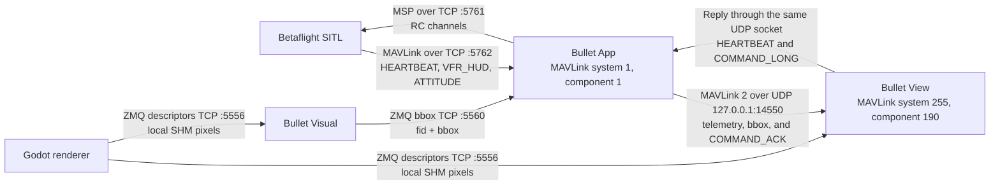

# Bullet App ↔ Bullet View MAVLink communication

This document describes the **current active link** between Bullet App and
Bullet View. View listens on `udpin:127.0.0.1:14550`; App sends the first
telemetry packet through `udpout:127.0.0.1:14550` from an ephemeral local UDP
port. View learns that App address from a valid App message and sends its
heartbeat and flight commands back through the same socket. App returns
`COMMAND_ACK` on its same socket. Both sides configure MAVLink 2. UDP 14551
is no longer used by this link.
If App restarts with a different source port, View learns the new return
address from its next valid App message.

App accepts control messages only from system/component `255/190`, and only
commands addressed to `1/1`. View accepts telemetry and command
acknowledgments only from App `1/1`. These are MAVLink source and target checks
on the local UDP link, not authentication.

## Messages used on the App–View link

| Direction | Message | When sent | Meaning |
| --- | --- | --- | --- |
| App → View, port 14550 | `HEARTBEAT` | About 1 Hz | Quadrotor heartbeat with firmware armed flag and App standby/active status. |
| App → View, port 14550 | `NAMED_VALUE_FLOAT` | Ten values about 10 times/s | Armed state, validity, readiness, height, hover duration, App mode, selected mission, phase, result, and detector readiness; see below. |
| App → View, port 14550 | `ATTITUDE` | Up to 20 Hz while SITL attitude is fresh | Roll, pitch, yaw, and angular rates relayed from SITL. |
| App → View, port 14550 | `ALTITUDE` | Up to 20 Hz while SITL `VFR_HUD` altitude is fresh | `altitude_local` in metres relative to the mission ground datum; other altitude fields are `NaN`. |
| App → View, port 14550 | `STATUSTEXT` | On phase/result changes or a denied command | Phase, result, fault, or command-denial reason. |
| App → View, port 14550 | `V2_EXTENSION` type 32768 | For each validated target-hit detection | Image fid and bbox coordinates or `null`; View overlays only a matching local frame. |
| View → App, reply on same socket | `HEARTBEAT` | About 1 Hz after the first valid App packet | Identifies View as a ground station and keeps its control link alive. |
| View → App, reply on same socket | `COMMAND_LONG` | When an operator requests a flight action | Arm, disarm, emergency disarm, apply target height, start, or land. |
| App → View, port 14550 | `COMMAND_ACK` | Once per addressed `COMMAND_LONG` processed | `MAV_RESULT_ACCEPTED` or `MAV_RESULT_DENIED`, addressed to View `255/190`. |

App considers View disconnected if its last View `HEARTBEAT` is more than
3 seconds old. It denies commands while that heartbeat is stale. During an
manually approved flight, loss of View heartbeat causes App to disarm on the ground or
enter landing when airborne. Automatic approval requires no View connection.
View also requires fresh App flight state before
enabling ordinary flight actions.

## `NAMED_VALUE_FLOAT` state

The ten values in each update share a `time_boot_ms` value so View can assemble
the four core flight fields into one state snapshot.

| Name | Values and meaning |
| --- | --- |
| `ARM_MODE` | `0` disarmed, `1` armed, as reported by SITL firmware. |
| `ARM_VALID` | `1` if App has received a SITL heartbeat within 3 seconds; otherwise `0`. |
| `MIS_READY` | `0` unavailable/prearm or transition, `1` disarmed idle, `2` armed idle, `3` flying, `4` fault/reset required. |
| `TAKEOFF_H` | Applied takeoff and hover height in metres above launch; hover/land defaults to 20 m and target-hit defaults to 10 m. Editable from View for manual target-hit before Start. |
| `HOVER_S` | Configured hover duration in seconds; target-hit uses a fixed 5 s before search. It is display-only in View. |
| `APP_MODE` | `0` automatic approval, `1` manual View approval. Mode is selected when App starts. |
| `APP_PHASE` | `0` prearm, `1` disarmed, `2` arming, `3` armed, `4` takeoff, `5` hover, `6` land, `7` disarming, `8` fault, `9` search, `10` center, `11` settle, `12` LOS, `13` commit. |
| `APP_MSN` | `1` hover-land, `2` target-hit. MAVLink named-value names are limited to 10 bytes. |
| `APP_RESULT` | `0` pending, `1` hit, `2` failed; `STATUSTEXT` gives the failure reason. |
| `VIS_READY` | `1` when a recent detector result is available, including a no-target result; otherwise `0`. Informational during startup; target search uses Visual after hover. |

View uses `ARM_MODE`, `ARM_VALID`, `MIS_READY`, and `TAKEOFF_H` together as its
flight state. It also displays `APP_MODE`, `APP_MSN`, `APP_PHASE`, and `APP_RESULT`. If the assembled
flight state becomes stale, View blocks normal flight commands. A successful
ACK alone does not complete an action in View: it waits for matching App state.

## `COMMAND_LONG` actions

Every command targets App system/component `1/1`. Unlisted parameters are
zero. App rejects non-finite or unsupported parameter combinations.

| View action | MAVLink command ID | Parameters | App constraint |
| --- | ---: | --- | --- |
| Arm | `400` (`MAV_CMD_COMPONENT_ARM_DISARM`) | `param1=1` | Manual approval mode; App must be disarmed and ready. |
| Disarm | `400` | `param1=0`, `param2=0` | Normal disarm is for the ground/armed idle state. |
| Emergency disarm | `400` | `param1=0`, `param2=21196` | Enters App fault and stops normal flight control. |
| Start selected mission | `300` (`MAV_CMD_MISSION_START`) | All zero | Manual approval mode with confirmed arm and fresh altitude; no preflight Visual requirement. |
| Apply target height | `31012` | `param1=height_m`, all others zero | Manual target-hit only, while disarmed or armed idle before Start; height 0.1–100 m. The slider displays 0–100 m, but 0 m cannot be applied. |
| Land | `21` (`MAV_CMD_NAV_LAND`) | All zero | Abort an active flight in either approval mode. |

App sends `COMMAND_ACK` with the original command ID and an accepted or denied
result. Its `result_param2` identifies the action: `1` arm, `2` disarm, `3`
emergency disarm, `4` start, `5` height, `6` land (`0` for an invalid action).
View checks the ACK source, target, command ID, and an action ID matching the
request (or `0`, which its current client also accepts). Accepted means
App accepted the request; View reports completion only after the corresponding
state change appears in App telemetry. For target height, View waits for
`TAKEOFF_H` to match the requested value. A denial or timeout is shown as a
command result.

## Scope and currently inactive handlers

The SITL link in the diagram is separate from the App–View link. App reads
SITL `HEARTBEAT`, `VFR_HUD`, and `ATTITUDE` over MAVLink TCP and requests the
last two at 50 Hz. App controls SITL using MSP RC channels over another TCP
connection. View does not connect directly to SITL. Its optional camera worker
connects to the renderer's image descriptor stream and reads local shared memory.

For target-hit, App forwards validated bbox results to View as MAVLink
`V2_EXTENSION` message type 32768 on the existing UDP link. The payload is a
little-endian uint16 JSON length followed by `{"fid": integer, "bbox": null |
{"x": integer, "y": integer, "width": integer, "height": integer}}`.
View reads matching camera pixels directly from the local renderer's ZMQ/SHM
stream on port 5556. The older bounding-box named-value parser remains for
compatibility but does not drive the fid-matched overlay.

View's worker can parse `DISTANCE_SENSOR` and recording named values, but the
current App bridge does not publish them.
Parameter and recording command code also remains in View, but the active
worker loop does not dispatch those requests. They are not part of the active
App–View MAVLink exchange described above.

## Implementation references

- App endpoints, command validation, ACKs, and telemetry: `bullet_app/src/bullet_app/view_link.py`
- App flight states and request constraints: `bullet_app/src/bullet_app/missions/base.py`
- App SITL connections and control loop: `bullet_app/src/bullet_app/mission.py`
- View endpoints: `bullet_view/src/bullet_view/main.py`
- View send/receive loop: `bullet_view/src/bullet_view/worker.py`
- View single-peer UDP transport: `bullet_view/src/bullet_view/peer_udp.py`
- View ACK and observed-state confirmation: `bullet_view/src/bullet_view/flight_control.py`
